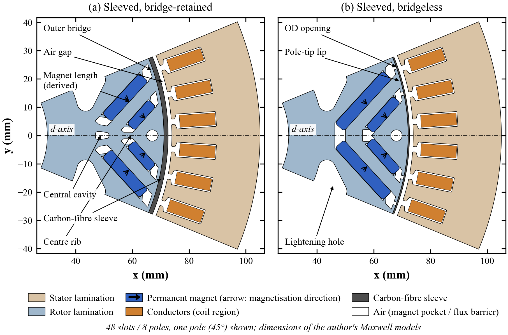
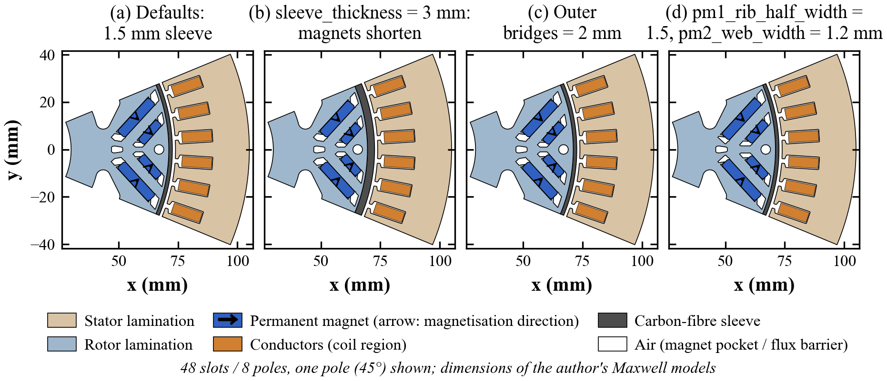
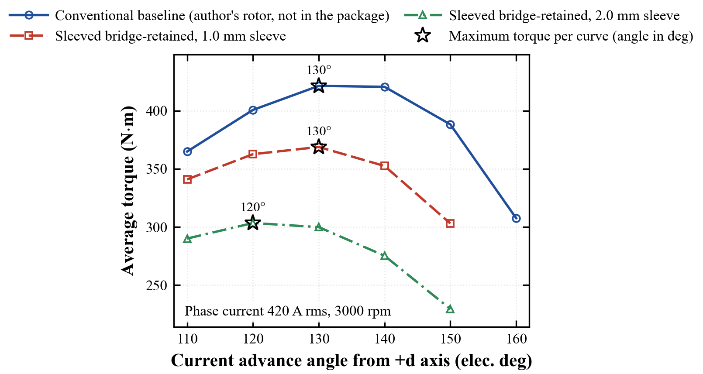
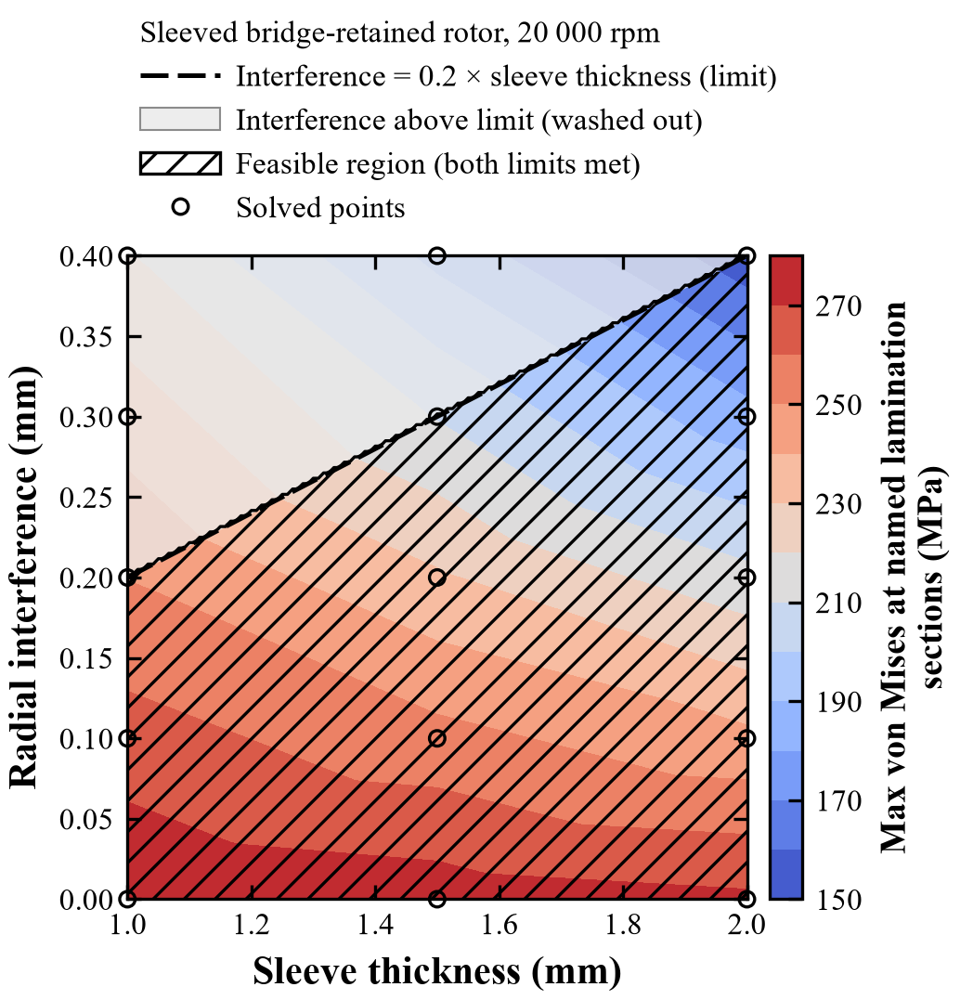

# sleeved-ipm-sweep

Coupled electromagnetic (Ansys Maxwell 2D) and mechanical (Ansys Mechanical APDL)
parametric sweeps for carbon-fibre-sleeved interior-permanent-magnet (IPM) rotors, driven
from Python, the command line or MATLAB. Companion toolchain to the paper *Comparative
Investigation of Bridge-Retained and Carbon Fiber Sleeved Interior Permanent Magnet Machines*
(W. Zhang, Z. Wu, W. Hua, ICEMS 2026); it does not reproduce the paper's results.

## 1. What it answers

For a 48-slot / 8-pole double-V IPM machine with a sleeved rotor: how much torque a design
gives against current advance angle, and how much stress its lamination and sleeve carry at
speed with an interference-fitted sleeve, over any set of geometry, operating-point or
material parameters. Two rotors are built, both constructed the way the author's original
Maxwell 2D models construct them, with those models' saved dimensions as defaults.

For the sleeve it also answers how close the composite is to failing: its constants can come
from fibre, matrix, fibre volume fraction and winding angle instead of being typed in, the
rotor can run hot or cold against the temperature at which the sleeve was fitted, and every
stress point reports ply failure indices and a safety factor for the sleeve.



*(a) Sleeved bridge-retained rotor (`sleeved_bridged`): straight slots closed by outer
bridges, a centre rib, magnet lugs and a central cavity, inside a carbon-fibre sleeve.
(b) Sleeved bridgeless rotor (`sleeved_bridgeless`): each slot opens to the OD through a
1 deg opening between pole-tip lips; the lamination is three separate pieces held by the
sleeve and the magnets. The air gap from sleeve to stator is the same in both.*

## 2. Try it in five minutes, without Ansys

Geometry, parameter checks, the APDL input deck and all plots work without Ansys. Python 3.10
or newer (tested with 3.13):

```bash
git clone <this repository> && cd sleeved-ipm-sweep
python -m venv .venv
.venv\Scripts\activate                 # Linux/macOS: source .venv/bin/activate
python -m pip install .

sipm params --topology sleeved_bridged                  # every parameter: value (units in docs/parameters.md)
sipm geometry --topology sleeved_bridgeless --out pole.png
sipm deck --topology sleeved_bridged --out deck.inp     # the APDL deck a stress run would solve
sipm composite --fibre carbon_sm --vf 0.55 --angle 30   # sleeve constants of a +/-30 deg carbon/epoxy winding
sipm plot examples/data/sample_em_results.csv --out figs
sipm plot examples/data/sample_mech_results.csv --sigma-allow 400 --out figs
python examples/04_plots_from_samples.py figs
```

The `plot` commands read sample results tables that this toolchain produced with Ansys
(`examples/data`, described in its [README](examples/data/README.md)). For development install
`python -m pip install -e ".[aedt,dev]"` and run `python -m pytest` (licence-free tests).

## 3. Run your own design

Every rotor parameter is one independent variable of the author's Maxwell model: per magnet
layer the d-axis crossing of the magnet centre line, the V angle, the slot width, the end gap,
the length ratio, the rib or web measure and the outer bridge thickness; plus sleeve
thickness, interference, lip depth and openings, materials and the operating point.
[docs/parameters.md](docs/parameters.md) lists all of them with unit, default and source
(`sipm params` prints them). Any parameter can be a column of a sweep.

```python
from sipm import default_params, post

p = default_params("sleeved_bridged", pm1_bridge_thickness=2.0, pm2_bridge_thickness=2.0)
post.geometry_plot(p, out="pole.png")
```



*The sleeved bridge-retained rotor rebuilt from four parameter sets: (a) defaults (1.5 mm
sleeve); (b) a 3 mm sleeve: the lamination shrinks because the air gap is held fixed, the
magnet layers stay in place and the magnets shorten; (c) both outer bridges 2 mm, which also
shortens the magnets; (d) a 3 mm layer-1 centre rib (`pm1_rib_half_width` = 1.5 mm) and 1.2 mm
layer-2 webs beside the cavity.*

**The magnet length is derived, not set**: each magnet is `pmk_length_ratio` (0.9) times the
free slot length from its inner end to the outer bridge, so anything that moves the bridge
(sleeve thickness, bridge thickness) changes the magnet. The derived lengths are in
`build_rotor(p).metrics["pm1_length"]` and `["pm2_length"]`; docs/methods.md section 1 gives
the construction.

**Infeasible designs are rejected before any solver starts**, with the violated constraint in
the message. For example `default_params("sleeved_bridged", pm2_angle=140.0)` passes the
parameter checks, but building the rotor raises

```text
GeometryError: bridge band does not cover the slot: the layer-2 slot meets its bridge circle beyond the q-axis (34.993 deg)
```

In a sweep such a row is recorded with status `invalid` and its message; the other rows are
solved. The full list of checks is in docs/methods.md section 1.6.

## 4. Run the solvers

| | Needs | Time per point (one workstation) |
|---|---|---|
| Electromagnetic (`em`) | Ansys Electronics Desktop with Maxwell (tested 2024 R1), `pip install ".[aedt]"` (PyAEDT 0.24.1) | 60-95 s alone, up to 3 min with other solvers running; about 0.9 GB RAM |
| Mechanical (`mech`) | Ansys Mechanical APDL (tested 2024 R1); no PyMAPDL, the driver writes a deck and runs it in batch | 13-26 s at the default mesh; about 0.5 GB RAM |

Ansys is found through `ANSYSEM_ROOTxyz` (AEDT) and `AWP_ROOTxyz` (MAPDL), newest version
first; `Config.aedt_version`, `Config.mapdl_version` or `Config.mapdl_exe` choose another.
Working files go to `$SIPM_WORKDIR`, or `<system temp>/sipm_runs`; nothing is written inside
the repository.

A sweep is a design table, one row per point. **Python:**

```python
from sipm import Config, Sweep, grid

cfg = Config()
em = Sweep("demo_em", "em", grid(sleeve_thickness=[1.0, 2.0], gamma=[110, 120, 130, 140]),
           topology="sleeved_bridged", cfg=cfg).run()
mech = Sweep("demo_mech", "mech", grid(sleeve_thickness=[1.0, 1.5, 2.0], interference=[0, 0.1, 0.2]),
             topology="sleeved_bridged", cfg=cfg).run()
```

**Command line**, from a TOML file (`[sweep]` name/physics/topology, `[base]` common
overrides, `[grid]` lists for a full factorial, `[[points]]` extra points, `[ansys]` settings;
see [examples/configs](examples/configs)):

```bash
sipm em-sweep examples/configs/em_sleeved_bridged.toml
sipm mech-sweep examples/configs/mech_sleeved_bridged.toml
```

**MATLAB**, through a thin wrapper that calls the command line (Python runs as a separate
process, so MATLAB, Python and Ansys never share DLLs):

```matlab
addpath('<repo>/matlab');  sipm.setup('C:\path\to\env\python.exe');
T = sipm.runSweep('demo', 'mech', sipm.grid('sleeve_thickness', [1 2], 'interference', [0 0.1 0.2]));
files = sipm.plotResults(fullfile(tempdir, 'sipm_runs', 'demo', 'results.csv'), 'mech', 'figs');
```

`matlab/examples/example_tiny_sweep.m` runs a six-point stress sweep and plots it.

Every finished point is cached in `<workdir>/<name>/cache/`; running the same sweep again
solves only the missing points (`--stop-after N` interrupts on purpose, `--retry-failed`
re-runs failed points). Before each point the runner waits until `min_free_ram_gb` (4 GB) of
RAM is free and stops cleanly if that does not happen within `ram_wait_timeout_s`; with
`max_solver_ram_gb` set it terminates a solver above that size and records the point as
failed. AEDT is restarted every `aedt_restart_every` (10) EM points.

## 5. Read the results

`<workdir>/<name>/results.csv` holds the inputs of each row, `status` (`ok`, `failed`,
`invalid`, `pending`), `message`, `wall_s` and:

* **EM**: `torque_avg`, `torque_max`, `torque_min` [N m] over 60 electrical degrees at
  `gamma` (current advance angle from the +d axis, 90 deg = pure q-axis current) and
  `current_rms`; `torque_ripple` = (max - min) / average; the waveform is in the cache.
* **Stress** [MPa]: `svm_rotor_max` = `svm_lam_max` is the headline lamination stress: the peak
  von Mises stress over **named load-carrying sections**, each also reported as
  `svm_<section>`:
  bridge-retained `bridge1`, `bridge2` (outer bridges), `rib1` (layer-1 centre rib), `web2`
  (layer-2 web), `qhole` (lightening-hole fillets); bridgeless `qhole` and the pole-tip lips
  `lip1_pole`, `lip1_q`, `lip2_pole`, `lip2_q`. `svm_lam_where` names the section that holds
  the peak, `svm_lam_r` / `svm_lam_theta` its position. These sections converge with the mesh
  within 2 %, except the **bridgeless lips, which do not** (3-11 %; they stay below 9 MPa at
  the default point and never set the headline). `svm_lam_max_all` (global lamination peak)
  and `svm_pm_max` (magnets) sit at sharp corners and contact edges and **grow with mesh
  refinement**; they are for information only. `sh_sleeve_max` is the peak sleeve hoop
  stress, `sleeve_open_fraction` the share of sleeve contact elements that opened.
* **Sleeve** [MPa, or dimensionless]: `sr_sleeve_min` and `sr_sleeve_max` (most compressive
  and largest radial stress; radial tension drives delamination), `tau_sleeve_max` (largest
  |r-theta shear|); ply failure indices `sleeve_fi_max_stress`, `sleeve_fi_tsai_wu`,
  `sleeve_fi_hashin_fibre`, `sleeve_fi_hashin_matrix` (1 = failure; the Tsai-Wu index is
  1 / `sleeve_sf`, so it scales with the load) and `sleeve_sf`, the
  smallest Tsai-Wu safety factor, at `sleeve_sf_r` / `sleeve_sf_theta`. The strengths behind
  them (`sleeve_Xt` ... `sleeve_S`) are illustrative class values: supply your material's.
  Sweeps cached by an earlier version are reused but lack these columns.

The two figures below are drawn from the sample tables in `examples/data`
(`python docs/make_figures.py --results`). They are outputs of this toolchain with the
default geometry, computed with Ansys 2024 R1 from `examples/configs`, not the paper's data.
Numbers, mesh studies and run times are in [docs/validation.md](docs/validation.md).



*Average torque at 420 A rms, 3000 rpm; the star marks each curve's maximum. The sleeved
bridge-retained rotor gives 369 N·m at 130° with a 1.0 mm sleeve and 303 N·m at 120° with a
2.0 mm sleeve: the non-magnetic sleeve widens the magnetic gap. The top curve (421 N·m at 130°)
is a **reference baseline** computed earlier with this toolchain for the author's conventional
bridge-retained rotor without a sleeve; that rotor's geometry is not part of the package,
which cannot rebuild it. Sources: `sample_em_results.csv`, baseline `sample_em_conventional.csv`
(`sample_em_bridgeless.csv` holds a bridgeless sweep).*



*Headline lamination stress of the sleeved bridge-retained rotor at 20 000 rpm with bonded
magnets, interpolated between 15 solved points (circles). The peak is at the lightening-hole
fillet at every point and falls as the interference fit tightens, more with a thicker sleeve.
A design must stay below an allowable stress (400 MPa here is an example; supply your
material's value; every point here is below it, so its line is not drawn) and keep the
interference below 0.2 × sleeve thickness (dashed; the area above is washed out). The hatched
region meets both. Source: `sample_mech_results.csv` (`sample_mech_bridgeless.csv` holds the
bridgeless sweep).*

## 6. Modelling assumptions and limits

Details in [docs/methods.md](docs/methods.md); checks and convergence in
[docs/validation.md](docs/validation.md).

* **Geometry**: the two sleeved rotors and the stator of the author's Maxwell models,
  reproduced to better than 1e-10 mm at 15 reference states, with two deliberate deviations
  in the bridgeless rotor: the centre-rib cut is derived instead of the model's hand-placed
  V notches, and the layer-1 OD openings sit at the true angle where the magnet centre line
  meets the OD (the model's expression has a typo). The conventional (unsleeved) rotor of
  earlier versions has been removed; `topology="conventional"` raises an error.
* **Magnets in the stress model are bonded by default**, as in the original Workbench model:
  the designed 0.1 mm clearance stays in the geometry but is bridged by the bond, so the
  magnets act as stiff ties. This hides magnets sliding in their pockets and bearing on the
  lugs, and the extra load that puts on bridges and ribs. `magnet_contact="frictional"` models
  loose magnets in the open clearance (bridge-retained rotor only; refused for the bridgeless
  rotor, where it does not converge reliably). At the default point the two differ strongly
  (layer-1 centre rib 13 MPa bonded, 147 MPa frictional; validation.md section 2).
* **Mechanical model**: 2D, half a pole with symmetry on both cut lines, plane stress by default
  (`plane="strain"` available), linear elastic, small deformation, centrifugal load plus
  interference and an optional uniform temperature (`mech_temperature` against the fitting
  temperature `mech_ref_temperature`, equal by default), no shaft. Sharp corners of the
  Maxwell outline are kept, so the stress is read at named sections (section 5).
* **Sleeve**: one cylindrically orthotropic body. By default it has the paper's Table II
  constants; with `sleeve_fibre` set they are derived (Chamis, Halpin-Tsai or rule-of-mixtures
  micromechanics, balanced +/- winding). The fibre and matrix presets are illustrative class
  values, not commercial grades. The failure indices are plane-stress ply criteria applied on
  both transverse planes of the ply: no through-thickness interaction, no cure residual stress,
  no end effects, no delamination growth or creep (docs/methods.md section 4).
* **Electromagnetic model**: 2D transient, one pole with odd periodicity, stranded coils with
  7 turns per slot and 2 parallel paths, generic BH curve, linear magnets; no end effects, skew,
  iron loss, eddy currents, temperature or demagnetisation check.
* **AC copper loss runs are disabled** until the strand geometry of the stator is defined.
* Tested on Windows with Ansys 2024 R1. The MAPDL driver should also work on Linux; the
  Maxwell driver needs a platform supported by PyAEDT.

## 7. Sleeve modelling: what is in, what is next

In now:

* **Composite constants from a specification**: fibre and matrix class, fibre volume
  fraction, micromechanics model and winding angle give the sleeve's elastic constants,
  density and thermal expansion; `sipm composite` prints them without Ansys.
* **Thermal load case**: a uniform rotor temperature against the temperature at which the
  interference is defined, validated against an extended closed-form solution.
* **Sleeve stress field and failure**: per-node sleeve stresses in cylindrical axes, the
  largest radial tension and r-theta shear, ply failure indices (maximum stress, Tsai-Wu,
  Hashin) and a safety factor at every stress point.

Proposed next:

1. **Sleeve eddy-current loss.** Carbon fibre conducts, far better along the fibre than across
   it. The 2D model only sees axial current, so a hoop-wound sleeve needs a 3D or analytically
   corrected loss model, and an angle-ply sleeve an axial conductivity in Maxwell.
2. **Multi-layer sleeves.** Hoop and helical layers in one sleeve, with per-layer winding
   tension as prestress instead of, or together with, the interference, and the matching
   multi-ring closed form for validation.
3. **Axial effects.** Generalised plane strain or an axisymmetric r-z model for the axial
   stress, the sleeve end effects and the gaps between magnet segments.
4. **Temperature in more detail.** Non-uniform temperature, matrix softening towards the glass
   transition, and cure residual stress.
5. **3D failure and long-term behaviour.** 3D failure criteria (Puck, LaRC, 3D Hashin),
   delamination, and creep relaxation of the prestress.
6. **Load cases as outputs.** A set of standard load cases reported together: standstill cold
   and hot, overspeed, and the lift-off speed.
7. **Calibration.** Fitting the ply data to measurements (ring tests) and propagating the
   uncertainty in fibre volume fraction.

## 8. Cite

Please cite the paper this toolchain accompanies (also in [CITATION.cff](CITATION.cff)):

> W. Zhang, Z. Wu and W. Hua, "Comparative Investigation of Bridge-Retained and Carbon Fiber
> Sleeved Interior Permanent Magnet Machines," in *Proc. International Conference on Electrical
> Machines and Systems (ICEMS)*, 2026.

```bibtex
@inproceedings{zhang2026sleevedipm,
  author    = {Zhang, Wentao and Wu, Zhongze and Hua, Wei},
  title     = {Comparative Investigation of Bridge-Retained and Carbon Fiber Sleeved
               Interior Permanent Magnet Machines},
  booktitle = {Proc. International Conference on Electrical Machines and Systems (ICEMS)},
  year      = {2026}
}
```

GitHub's "Cite this repository" button gives the same reference from `CITATION.cff`.

## Acknowledgement

This release was supported by the N-ZEEE network through its Flexible Fund.

## Licence

MIT, see [LICENSE](LICENSE).
