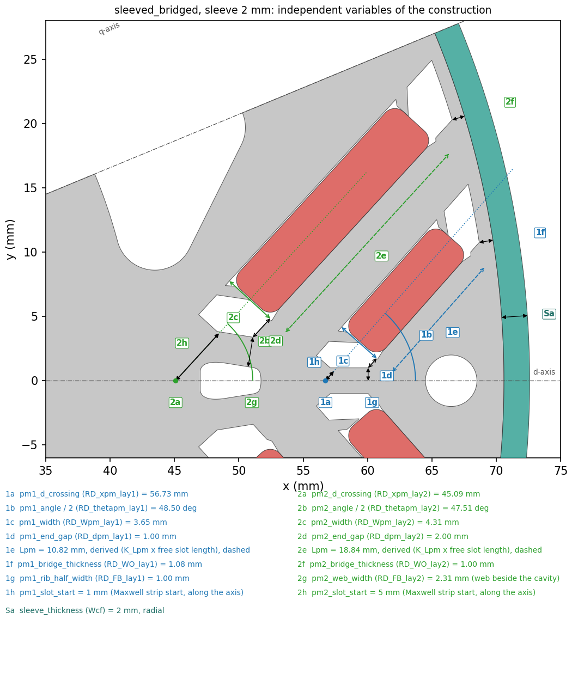
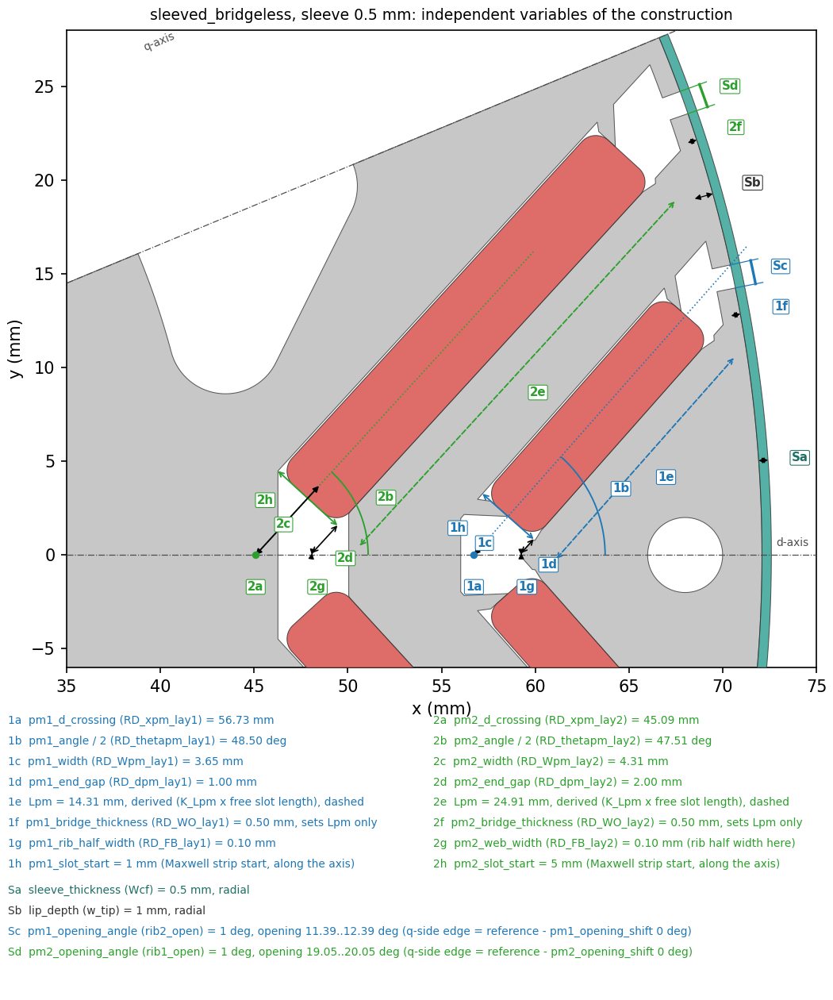

# Methods and assumptions

This toolchain automates the type of coupled electromagnetic and mechanical sweeps
described in the companion paper (Zhang, Wu, Hua, ICEMS 2026) on an **illustrative**
48-slot / 8-pole double-V IPM machine. The geometry defaults are those of the author's
original Maxwell models (section 1); the materials are those published in Tables I and II of
the paper; everything else is an illustrative choice listed in
[parameters.md](parameters.md). The toolchain does not reproduce the paper's machine
or its numbers, and none of the figures in the paper were produced with it.

## 1. Geometry (`sipm.geometry`)

The rotor and stator are constructed the way the author's original Maxwell 2D models
construct them (sleeved bridge-retained `01_ICEM_01_simplerotor`, sleeved bridgeless
`02_ICEM_01_teslamotor1`). The defaults are the saved states of those models; each rotor parameter is one independent variable of the model
(the "Maxwell variable" column of [parameters.md](parameters.md)).

**Frame and modules.** Pole frame: shaft axis at the origin, d-axis of the modelled pole on
+x, the pole spans -pi/p .. +pi/p; mm. `primitives` holds exact segments (line, circular arc,
cubic Hermite curve), fillets, the `MoveEdges` offset and the solver `Loop`; `csg` evaluates
unite/subtract/intersect expressions of line/arc regions exactly (every primitive edge is
split at its exact intersections with every other edge, each piece is kept if the
expression differs on its two sides, the pieces are chained into loops); `construction`
evaluates the `RD_*` points of one magnet layer; `rotor` builds the two sleeved topologies;
`checks` raises `GeometryError` for infeasible designs and returns derived metrics;
`locations` defines the named stress sections (section 3); `stator` builds the stator pole
pitch.

The package builds only the two sleeved rotors. A conventional (unsleeved) bridge-retained
rotor was part of earlier versions; it has been removed and its geometry is not distributed.
`default_params("conventional")` raises a ValueError that says so. The only trace of it is
the reference torque curve in `examples/data/sample_em_conventional.csv` (README, figure 2),
a table solved earlier with that rotor, which the package cannot rebuild.

### 1.1 One magnet layer

Layer k (1 = outer, 2 = inner) is a straight slot along the magnet axis:

* `pmk_d_crossing` (`RD_xpm`): where the magnet centre line crosses the d-axis;
* `pmk_angle` (2 x `RD_thetapm`): included V angle; the axis makes half of it with the d-axis;
* `pmk_width` (`RD_Wpm`): slot width = nominal magnet thickness. Wall 1 (pole side) crosses
  the d-axis at x1 = xpm + W/(2 sin th), wall 2 (q side) at x2 = xpm - W/(2 sin th).

The construction points (the model's `RD_x<n>, RD_y<n>`): P5 = wall 1 at height FB + INNO
(the slot's inner pole-side corner); P8 = P5 + `pmk_end_gap` (`RD_dpm`) along the axis and
P9 = P8 + W across it (the magnet's inner corners); P3 = wall 1 on the bridge circle
r_lam - `pmk_bridge_thickness` (`RD_WO`). The **magnet length is derived**:

    Lpm = pmk_length_ratio x (|P3 - P5| - pmk_end_gap)          (RD_Lpm = RD_K_Lpm x RD_distance3)

P10/P11 are the outer corners. At the saved states the derived lengths are 10.825 / 18.841 mm
(sleeved bridge-retained, 2 mm sleeve) and 14.312 / 24.909 mm (bridgeless, 0.5 mm sleeve); they are exposed as `rp.metrics["pm1_length"]`,
`rp.metrics["pm2_length"]`.

Layer 1's inner end is the flat rib line y = `pm1_rib_half_width` (`RD_FB_lay1`, half the
centre rib). Layer 2's inner end is tilted by `pm2_inner_tilt` (`RD_thetaINNO_lay2`) and lies
`pm2_web_width` + `pm2_inner_offset` above the d-axis at P5; `pm2_web_width` (`RD_FB_lay2`) is
also the thickness of the webs between this end and the central cavity.

**When the sleeve thickens** the lamination OD is r_lam = stator bore/2 - 1.32 mm (air gap)
- `sleeve_thickness`. The layers do not move (P5, P8, P9 depend only on the layer variables);
the bridges stay `pmk_bridge_thickness` below the new OD, so P3 moves inwards and the magnets
shorten: sleeved bridge-retained, sleeve 0.5 / 1 / 1.5 / 2 mm, Lpm1 = 12.564 / 11.987 /
11.407 / 10.825 mm, Lpm2 = 20.403 / 19.884 / 19.363 / 18.841 mm.

### 1.2 Construction order per topology

Sleeved, bridge-retained (model tree order): annular sector (shaft radius 30 mm to r_lam)
- two q-axis lightening holes (inner arc `q_hole_inner_radius` 42 mm over
+-`q_hole_half_angle` 20 deg about the q-axis, straight sides to the apex at
`q_hole_apex_radius` 56 mm, `q_hole_fillet` 3 mm on the three corners)
- layer-1 strips (width W, from `pm1_slot_start` beyond the d-axis crossing, through the OD)
+ centre-rib band |y| <= `pm1_rib_half_width`
- layer-2 strips (from `pm2_slot_start`), each minus its tilted end band (height
FB2 + INNO2, rotated by -`pm2_inner_tilt` about (xpm2, 0), shifted W/sin(th) along x)
- central cavity + magnet lugs - corner reliefs - d-axis hole (diameter `d_hole_diameter`,
centre at r_lam - `d_hole_depth`) + outer bridge bands (annulus r_lam - WO .. r_lam that
closes each slot). Lower half: mirror images.

Sleeved, bridgeless: as above without cavity and bridge bands, then + pole-tip lips
(annulus r_lam - `lip_depth` .. r_lam) with two angular openings per side, then - the rib cut
(1.4), which separates the lamination into three pieces (q-axis body, middle piece, pole
cap). Each opening is `pmk_opening_angle` wide; its q-side edge lies `pmk_opening_shift`
(default 0 for both layers) towards the d-axis from the opening reference angle, the polar
angle where the layer's magnet centre line meets the OD (1.4; the model differs for layer 1).

Central cavity (sleeved bridge-retained): two Hermite curves and two lines
per half through the layer-2 points FB = P5 - FB2 (sin, cos)(tilt) and FBd = P6 + 1 mm, with
the model's fixed numbers (table in [parameters.md](parameters.md)).

**Magnet fit (sleeved rotors).** The magnet's q-side face is moved `pm_side_clearance`
(0.1 mm) off the q-side wall, its inner end `pm_end_clearance` (0.1 mm bridge-retained, 0 in
the bridgeless model) towards the outer end, and its four corners are rounded with
`pm_corner_radius` (1 mm). The pole-side face stays on wall 1. Lugs (added to the lamination)
and corner reliefs (removed) are the model's fixed polygons, attached to the nominal magnet
corners. Magnetisation: normal to the long faces, towards the pole side (unchanged).

### 1.3 Model helpers replaced by derived geometry

The Maxwell models contain numbers that were placed by hand to suit the saved state. Where
such a number is a design feature it is a parameter (default = model value); where it only had
to cover something it is derived:

| Model helper | Package | Effect at the model's states |
|---|---|---|
| bridge bands over fixed spans 29-38 deg / 38-45 deg (model frame) | band of each layer up to the angle halfway between the two slot mouths | none (identical outlines) |
| lips over fixed spans with seams at 7 deg / 18 deg | full lip band minus the openings | none |
| rib band x from xpm1 - 2 to xpm1 + 6 mm | rib band along the whole d-axis inside the lamination | none |
| tilted end band 24 mm long | long enough to cross the slot | none |
| strip length 50 mm | strip runs through the OD | none |
| lug coordinates 2.15295.. / 1.82450.. mm | half the slot width W/2 of that layer | none |
| hole centre 68.5 mm - (g - 1.32 mm) | r_lam - `d_hole_depth` (4.1 mm) | none |
| rib-cutting prisms with hard-coded corners (bridgeless) | derived rib cut, 1.4 | flat instead of V notch, see 1.4 |
| strip inner end 1 mm / 0 + 5 mm (MoveEdges) | `pm1_slot_start`, `pm2_slot_start` | parameters |
| 1 deg openings | `pmk_opening_angle` | parameter |
| layer-1 opening reference `angle_temp_lay1` (with `RD_xpm_lay2`) and 1.5 deg shift | true reference angle, `pm1_opening_shift` = 0 | layer-1 openings 0.28-0.34 deg further from the d-axis, see 1.4 |
| magnet MoveEdges 0.1 mm, fillet 1 mm | `pm_side_clearance`, `pm_end_clearance`, `pm_corner_radius` | parameters |

### 1.4 Bridgeless rotor: deliberate deviations from the model

These are the only two places where the package outline differs from the bridgeless model;
`tests/test_maxwell_reference.py` checks both exactly against every bridgeless fixture
(the deviating segments are the only unmatched ones, and the lamination areas differ by
exactly the amounts below). Everything else, the layer-2 openings included, matches within
1e-6 mm.

**Rib cut.** The model cuts its 0.1 mm centre ribs with two prisms whose q-side end is a V notch with a
hard-coded apex (x = 44.627 and 55.416 mm; the second apex is 0.007 mm off the d-axis, so the
model is not exactly symmetric). The package derives the cut: for each layer the air region is
the convex hull of the strip's two inner-end corners, the slot corner P5 and those inner
magnet corners P8, P9 that lie before the strip's inner end, together with their mirror
images about the d-axis. On the pole-cap and middle-piece side this reproduces the model's
outline; on the q-body side the edge is flat instead of the V notch, which leaves 1.20 mm^2
(layer 1, middle piece) and 5.76 mm^2 (layer 2, q-axis body) more steel per pole at the saved
state.

**Layer-1 OD openings.** The model places each opening relative to `angle_temp_layk`, meant
as the polar angle where the layer's magnet centre line meets the OD: the line
(xpm, 0) + t (cos th, sin th) meets r = r_lam at x = xpm sin^2 th + cos th sqrt(r_lam^2 -
xpm^2 sin^2 th), y = -xpm sin th cos th + sin th sqrt(...). The model's expression for layer 1
writes `RD_xpm_lay2` instead of `RD_xpm_lay1` in the first term of x (every other term, and
the whole layer-2 expression, use the layer's own crossing), so its layer-1 reference is
13.616 deg at the saved state instead of the true 12.394 deg. The layer-1 opening's q-side edge
is then put 1.5 deg towards the d-axis (12.116 deg), while the layer-2 opening starts at its
reference with no shift. The mixed variable is taken as a typo and the 1.5 deg as a hand
correction for it: together they land the opening near, but not at, the true reference. The
package uses the true angle for both layers and `pm1_opening_shift` = 0, so both openings span
[reference - `pmk_opening_angle`, reference] (`construction.py`, `opening_reference`;
`pm1_opening_shift` = 1.5 still moves the opening as the model's shift does, but from the true
reference). At the saved state the layer-1 opening is 11.394-12.394 deg instead of
11.116-12.116 deg (0.278 deg further from the d-axis; 0.278-0.338 deg over the fixture states).
The lip sector between the two positions, 0.347 mm^2 per side at the saved state, moves from
the middle piece to the pole cap: per pole the pole cap gains 0.694 mm^2 and the middle piece
loses 0.694 mm^2 (net with the rib cut: +0.502 mm^2). The opening lies inside its slot mouth
under the lips with at least 0.64 deg to spare at the default state and at every corner of the
bridgeless sweep ranges (feasibility check, 1.6).

### 1.5 Curves to the solvers, stator

The Hermite curves of the central cavity are exact in the geometry and in
the reference test; both solvers receive the same tangent-continuous biarcs, at most
`BIARC_TOL` = 5e-4 mm from the true curve.

Stator (model `Circle1`): bore 147.84 mm, OD 210 mm (the paper's Table I lists 220 mm); slot
opening 1.9 mm wide up to `slot_tip_depth` 1.22 mm beyond the bore corner, taper at
`slot_tip_angle` 70 deg to `slot_width` 5.27 mm, parallel sides to the flat bottom at bore
radius + `slot_depth` 15.75 mm; 0.3 mm fillet on every slot corner including the two bore
corners. Conductors: `cond_count` = 8 touching rectangles 1.57 mm (radial) x 4.3 mm from
76.8 mm, merged into one coil region per slot that carries `hairpin_layers` = 7 turns (model
`Nac`). In the two sleeved designs the stator is a history-purged body; the reference
outline (`tests/fixtures/maxwell_ref/stator_saved.json`) was replayed from a Maxwell design
of the same stator that keeps its history.

### 1.6 Feasibility checks and derived metrics

`GeometryError` is raised, with the violated constraint in the message, when: the slot does
not reach the bridge circle beyond the magnet (negative magnet); the derived magnet is
shorter than 2 `pm_corner_radius` + 0.5 mm; the two slot mouths overlap at the bridge circles
or the layer-2 slot meets its bridge beyond the q-axis (bridge band cannot cover the slot);
layer 1 does not cross the d-axis outside layer 2; a magnet overlaps steel; air regions that
must stay separate merge (slots, cavity, holes); the steel between air regions, or between an
air region and the bore, is below `min_web` (for the lightening holes this is checked before the
outline is built: their inner arc must stay `min_web` outside the bore); the q-axis web is below `min_q_web`; an OD
opening does not lie inside its slot mouth under the lips. `rp.metrics` holds `pm1_length`,
`pm2_length`, `pmk_magnet_area`, `pmk_bridge_min`, `pmk_rib_min`, `layer_web`, `pm2_web_min`,
`q_web`, `lamination_area` and `lamination_pieces`. Every rotor is symmetric about the d- and
q-axis (tested), which the half-pole mechanical model needs.

**Feasible sweep ranges.** Every corner of the original sweep ranges builds: sleeved
bridge-retained, sleeve 0.5 / 2 mm x `pm1_bridge_thickness`, `pm2_bridge_thickness`,
`pm1_rib_half_width`, `pm2_web_width` 0.5 / 1.5 mm (32 corners); bridgeless, sleeve 0.5 / 2 x
`lip_depth` 0.5 / 2 x bridge thicknesses 0.5 / 1.5 mm (16 corners).

### 1.7 Reproduction of the Maxwell models

`tests/fixtures/maxwell_ref` holds the exact outlines of the two sleeved models at their saved
states, of their stator, and of 7 (bridge-retained) and 6 (bridgeless) further variable sets spanning the sweep
ranges, generated by replaying the models' construction history
(`tools/make_maxwell_fixtures.py`; the replay agrees with the vertex positions AEDT caches in
the files to 1.5e-13 mm). `tests/test_maxwell_reference.py` requires every vertex, arc centre
and radius, and curve sample within 1e-6 mm, every region area within 1e-6 relative and the
derived magnet lengths equal to `RD_Lpm` within 1e-6 mm; the largest deviation found is
7e-11 mm. The only exceptions are the two bridgeless deviations of 1.4 (rib cut, layer-1 OD
openings), which the test checks exactly instead.

## 2. Electromagnetic model (`sipm.maxwell`)

* Maxwell 2D transient (XY), driven through PyAEDT; one pole (45 deg) with
  master/slave boundaries, `B_slave = -B_master` (odd periodicity); zero vector potential
  on the stator OD; model depth = `stack_length`; symmetry multiplier = poles, so torque,
  flux linkage and losses are for the whole machine.
* A rotating band encloses the rotor; its boundary is the middle of the air gap between
  the sleeve OD and the stator bore. Two air rings on either side of it carry a
  length-based mesh of `mesh_gap`.
* Current excitation, stranded conductors (one turn per conductor, `parallel_paths`
  parallel branches):

  `i_k(t) = Imax cos(w_e t + gamma - phi_k)`, `Imax = sqrt(2) current_rms`,

  where the rotor d-axis is at electrical angle 0 at t = 0, `phi_k` is the magnetic axis
  of phase k computed from the layout (the angle where the phase's own MMF drives flux
  radially outwards, `phi = arg(sum s e^{j p theta}) - 90 deg`) and `gamma` is the current
  advance angle from the +d axis (90 deg = pure q-axis current, > 90 deg adds negative
  d-axis current). The rotor turns in the positive direction, so positive torque is
  motoring torque. These conventions are verified by the no-load check in
  [validation.md](validation.md).
* Average torque is the mean over `em_span` electrical degrees (default 60, one period of
  the 6th harmonic) with `em_step` = 2 electrical degrees; the end point is excluded.
* Only `gamma` and `current_rms` are design variables in a project; any other parameter
  change creates a new project, which is closed and deleted afterwards unless
  `Config.keep_aedt_projects` is set.
* Materials: lamination = generic non-oriented steel BH curve (see `sipm.materials`; not
  the 27SW1400 grade named in the paper, whose data are not shipped), user curve via
  `lam_bh="path.csv"` or an AEDT library material via `lam_bh="aedt:<name>"`; magnets =
  linear, `pm_br` (1.40 T, the paper says G52UH has "higher than 1.40 T"), `pm_mur` 1.05,
  non-conducting; sleeve = non-magnetic and, by default, non-conducting (a conducting sleeve:
  2.1); no other eddy currents in torque runs, no iron loss, no temperature dependence, no
  end effects, no skew.

**AC loss factor (optional).** `MaxwellSession.ac_loss` re-builds the model with solid
conductors (eddy effects on, series connection enforced by the current-driven solid
winding), runs 1.5 electrical periods at the requested speed and reports
`Kac = p_ac / p_dc`, where `p_ac` is the mean of Maxwell's `SolidLoss` over the last
period and `p_dc = slots x layers x (I_rms / parallel_paths)^2 R_dc` with
`R_dc = stack_length / (sigma A_conductor)`. Both refer to the active length only.

### 2.1 Sleeve eddy-current loss (2D, axial current)

Carbon fibre conducts, so the slot and winding harmonics that move relative to the rotor drive
eddy currents in the sleeve, a rotor loss next to the magnets. The model stays 2D. This section
says what that 2D loss is and what it is not.

**Conductivity.** A unidirectional ply conducts along the fibre with `sigma_L`
(`sleeve_sigma_fibre`) and across it with `sigma_T` (`sleeve_sigma_transverse`); the ply is
transversely isotropic, so the through-thickness value is `sigma_T` too. With the fibre at angle
t from the hoop direction, f = (cos t, sin t) in (hoop, axial), the in-plane tensor is
`sigma_T I + (sigma_L - sigma_T) f f^T`:

    sigma_hoop,hoop   = sigma_L cos^2 t + sigma_T sin^2 t
    sigma_axial,axial = sigma_L sin^2 t + sigma_T cos^2 t
    sigma_hoop,axial  = (sigma_L - sigma_T) sin t cos t

The off-diagonal term changes sign with t and cancels between the two plies of a balanced
+/- t winding. The 2D model carries only axial (z) current, so it sees the sleeve only through
`sigma_axial,axial`: for a hoop winding (t = 0) that is `sigma_T`, the across-fibre value; for
fibres along the axis (t = 90 deg) `sigma_L`. The layers of `sleeve_layers` lie side by side
for an axial current and see the same axial field (thin, resistance-limited sleeve), so they are
in parallel: the effective value is the thickness-weighted mean of the layer values
(`sipm.composite.axial_conductivity`, `Params.sleeve_conductivity_axial`). The Maxwell model
keeps one homogeneous sleeve object with this value.

Both conductivities default to 0: the sleeve does not conduct, and the model, the cache keys
and every result are those of earlier versions. No conductivity is shipped as a material
property. As a class statement only, for orientation: carbon/epoxy laminates are often quoted
at 1e3-1e5 S/m along the fibre and orders of magnitude lower, strongly process-dependent,
across it. Measure the laminate you use.

**Cache keys.** The two conductivities are left out of the sweep point key while they are 0
(`sipm.sweep.KEY_OMITTED_AT_DEFAULT`). The Maxwell model key (`em_model_key`) leaves them out
always and adds the derived axial conductivity when it is > 0. The winding angle and the layer
spec stay mechanical-only fields of that key: they change the EM model only through the axial
conductivity, which is in the key. So a non-conducting sleeve, whatever its winding, keeps its
old key; two specs with the same axial conductivity share one Maxwell model; ply values that
give no axial conductivity (a hoop winding with `sigma_T = 0`) leave the model unchanged and
report a 2D loss of exactly 0.

**Maxwell model.** With `sleeve_conductivity_axial > 0`, an `em` run:

* sets the sleeve material conductivity and switches eddy effects on for the Sleeve object
  (directly through `SetEddyEffect`; PyAEDT's `eddy_effects_on` only lists materials of at least
  1e5 S/m as conductors and silently skips a carbon sleeve below that);
* keeps the mesh of the non-conducting model (sleeve at `mesh_rotor`), so the two models differ
  only by the conductivity: a 0.3 mm sleeve mesh changed the loss by 0.03 % at the check point
  but shifted the torque by 0.07 % through the changed mesh alone (docs/validation.md, 13);
* simulates a lead-in of one loss period plus `max(2, ceil(em_span / 60))` loss periods
  (180 electrical degrees at the defaults, three times a torque run), with the time step
  `em_step`;
* reports `torque_avg`, `torque_max`, `torque_min`, `torque_ripple` over the last `em_span`
  degrees, as a torque run does, and the sleeve loss.

*Net current.* The sleeve is a full ring whose axial current returns through the sleeve at its
ends. With an ideal (resistance-free) end return the only constraint is zero total current
through the ring's cross-section. The model holds one pole with odd periodicity, so the sleeve
current density is anti-periodic over a pole pitch and the ring total is zero by symmetry; the
modelled pole carries a net current of alternating sign from pole to pole. No constraint is
needed, and none is added. Maxwell 2D leaves the net current of an eddy-enabled object that is
not part of a winding free (`E_z = -dA/dt`, no added uniform field): such a run gave the same
loss to 1e-7 as the sleeve made a 0 V solid voltage winding. A zero-current constraint on a
passive solid is available (a 0 A solid current winding), but on the one-pole sector it imposes
zero net current per pole, which the ring does not have: it removed 9 % of the loss at the
check point. The thin-shell estimate below reproduces both cases (docs/validation.md, 13).

*Loss and its average.* Only the sleeve is a solid conductor, so Maxwell's `SolidLoss` is the
sleeve loss, for the whole machine (symmetry multiplier = poles) and the stack length. In the
rotor frame every field quantity of an integer-slot winding with balanced sinusoidal currents
repeats after one phase belt, 60 electrical degrees (advancing the rotor by q slots maps the
slots and the current pattern onto themselves), and so does the loss
(`sipm.eddy.loss_period_deg`). `sleeve_loss_w` is the time average over the last such period
(trapezoid rule, `sipm.eddy.period_average`), `sleeve_loss_rel_change` its relative change from
the period before (the convergence check of the average), `sleeve_loss_frac` = loss / shaft
power with shaft power = `torque_avg` x mechanical angular speed (NaN at zero or negative
torque). The start-up transient is short: Maxwell's t = 0 sample is a static solution without
eddy current, and from the first step on the loss waveform repeats with the 60-degree period to
1e-5 at the check points.

*Resolution.* `sleeve_skin_depth_mm` is the skin depth at the slot-passing frequency seen from
the rotor, f_s = slots x rpm / 60 (2400 Hz at 3000 rpm), and `sleeve_skin_ratio` that depth over
the sleeve thickness; `sleeve_mesh_mm` and `sleeve_steps_per_slot` (time steps per slot-passing
period = 30 deg / `em_step`, independent of speed because `em_step` is in electrical degrees)
are reported with it. A conducting run is refused when the mesh is coarser than half the skin
depth or when there are fewer than `MIN_STEPS_PER_SLOT` = 15 steps per slot period. The
`em_step` default of 2 deg, chosen for torque, gives exactly 15 and resolves the loss to about
1.3 % (measured against 1 and 0.5 deg, about second order in the step); `em_step` = 1 deg gives
about 0.4 % and doubles the run time (docs/validation.md, 13). The skin depth matters only for
much higher conductivities: at 1e4 S/m and 2400 Hz it is about 100 mm, against a 1.5 mm sleeve,
and the departure from the resistance-limited regime (the shell reaction) sets in before the
skin depth approaches the thickness (exponent 0.94 from 1e5 to 1e6 S/m with the skin depth still
7 times the thickness).

*Torque.* The eddy currents brake the rotor. Over a period the power balance is
sum <i dpsi/dt> = T Omega + P (the stored field energy is periodic): at no load the stator
delivers no power and the torque falls by exactly P / Omega; under load the current-driven
stator's electromagnetic power changes too and supplies part of the loss, so the torque falls by
less (0.88 P / Omega at the check point, linear in sigma like the loss). At realistic carbon
conductivities the change is far below the torque resolution of the model
(docs/validation.md, 13).

**Resistance-limited loss and the thin-shell estimate.** If the sleeve's own currents do not
change the field (thin compared with the skin depth and a small shell reaction; the
proportionality of the loss to sigma checks it), the rotor-frame field is that of the
non-conducting model. With axial current only, `E_z = -dA/dt + C(t)` in the rotor frame,
`J_z = sigma E_z`, and zero total current fixes the uniform field to the cross-section mean,
`C = <dA/dt>`:

    P = sigma L  int int (dA/dt - <dA/dt>)^2 r dtheta dr        (time average)

(`sipm.eddy.shell_loss_from_potential`; L = stack length, the integral over the full ring and
the sleeve thickness). In harmonic form, a rotor-frame harmonic of the radial flux density
`B_r = c_nk exp(i(n theta + w_k t))` has `A = r c_nk / (i n)` and `E = -w_k r c_nk / n`, so for a
sleeve of thickness d at mean radius r_m

    P = sigma L d 2 pi r_m  sum_{n != 0} sum_k (w_k r_m / n)^2 |c_nk|^2

(`sipm.eddy.shell_loss_from_br`). The n = 0 term is absent: B_r has no ring mean, and the ring
mean of E is exactly what zero total current removes. The loss is proportional to sigma and,
at fixed current and current angle, to the speed squared. This is the independent estimate the
FE loss is checked against in docs/validation.md, 13.

**What 2D cannot say.** The 2D model has axial current only and no end region:

* In a **hoop-wound sleeve** the easy path is circumferential, along the fibres. The 2D model
  contains only the axial, across-fibre current of that sleeve (`sigma_T`) and nothing of the
  along-fibre currents that close circumferentially, so for hoop windings it gives the
  axial-current part of the loss, not the total, which may be much larger.
* In a **helical (angle-ply) layer** the axial conductivity is larger, and the 2D model assumes
  every axial current filament returns through a resistance-free end. The real return runs
  circumferentially through the sleeve's end regions and adds resistance, so the 2D loss
  over-counts for such layers by omitting the end return.
* No 3D or end-effect correction is applied. `sleeve_loss_w` is the 2D axial-current loss of
  the active length, with ideal end return, of a homogeneous sleeve with the axial conductivity
  above; it excludes PWM and current-ripple harmonics, magnet eddy loss and any thermal coupling.

## 3. Mechanical model (`sipm.mapdl`)

The deck is plain APDL, written by Python, run in batch, and post-processed into a
`key = value` text file. Assumptions:

1. **Domain:** half a pole (22.5 deg). The rotor is symmetric about the d-axis and the
   q-axis, so zero tangential displacement (nodal cylindrical axes) on both cut lines is
   exact for centrifugal load and interference.
2. **2D plane stress** by default (`plane="strain"` available), PLANE183, free triangular
   mesh, `mech_mesh` globally, `mech_mesh_fine` on all lines shorter than 3 mm (fillets,
   bridges, rib, lug faces), at least three quadratic elements through the sleeve (a layered
   sleeve: at least two through every layer, section 4.6).
3. **Materials:** linear elastic, small deformation (`NLGEOM,OFF`), isotropic lamination
   and magnets (Table II). The sleeve is cylindrically orthotropic: element axes come from
   a local cylindrical system (`ESYS`), x = radial, y = hoop, z = axial (see section 4). A
   layered sleeve (`sleeve_layers`) is one such material per layer, perfectly bonded
   (section 4.6).
4. **Sleeve-lamination contact:** surface-to-surface (CONTA172/TARGE169), augmented
   Lagrange, friction `mu_sleeve` (default frictionless). The **radial interference** is a
   contact offset `CNOF = interference`, ramped over the load step (KEYOPT(9) = 4). The
   geometry itself has coincident surfaces. If the lamination grows more than the sleeve,
   contact can open locally; the open fraction is reported (`sleeve_open_fraction`).
5. **Magnet-pocket contact** (`magnet_contact`), every magnet face against the lamination:
   * `bonded` (default): as in the original Workbench model of these rotors, the magnets are
     bonded to the pocket (CONTA172 KEYOPT(12) = 5, MPC formulation KEYOPT(2) = 2). The
     designed 0.1 mm clearance (`pm_side_clearance`, `pm_end_clearance`) stays in the
     geometry and is bridged by the bond: the initial gap is ignored (KEYOPT(9) = 1, the
     faces are not moved) and the absolute pinball radius, 3 x the clearance (at least
     0.05 mm), reaches across it. This stands for a magnet glued into its pocket with the
     glue line filling the clearance; the bond is rigid, so it transmits tension, shear and
     compression and the magnets act as ties between the lamination pieces of the
     bridgeless rotor.
   * `frictional`: surface-to-surface contact with friction `mu_magnet` (default 0),
     augmented Lagrange, the designed clearance open at the start (KEYOPT(9) = 0), faces that
     touch closed within ICONT = 0.005 mm, contact stabilisation damping in the load step
     (KEYOPT(15) = 2) to keep the loose magnets from drifting before they seat. Its energy is
     reported relative to the strain energy (`stab_energy_ratio`). Not supported for the
     bridgeless rotor (a clear error): there the loose magnets do not converge reliably
     (validation.md section 7).
   No pre-stress, no adhesive stiffness of its own.
6. **Load:** centrifugal load at `mech_rpm` about the shaft axis, together with the
   interference and, optionally, a uniform temperature (section 4.3) and a winding prestress
   of the sleeve (`sleeve_layer_prestress`, section 4.6), in one load step. No shaft (the
   lamination bore is traction free), no electromagnetic forces.
7. **Outputs** (MPa, nodal von Mises averaged within each body):
   * `svm_lam_max`, the headline lamination stress, is the peak over **named load-carrying
     sections** (`sipm.geometry.locations`). The global peak of these rotors sits at sharp
     corners of the Maxwell outline (slot ends, lug and relief corners, rib-cut corners),
     which are singular in a linear-elastic model and grow without limit under mesh
     refinement; the geometry keeps the Maxwell outline (no fillets). Each section is a
     region of the lamination found from its own boundary edges; its peak is taken over
     the section's span minus `stress_corner_margin` (0.5 mm) at each end where it meets a
     sharp corner:
     - bridge-retained rotor: `bridge1`, `bridge2` (outer bridge of each layer, between the
       slot's closing arc and the OD over the slot mouth), `rib1` (layer-1 centre rib, under
       the flat inner end of the slot), `web2` (layer-2 web, the band `pm2_web_width` thick
       under the tilted inner end of the slot), `qhole` (a 1 mm band along the three fillets
       of the q-axis lightening hole; smooth, no margin);
     - bridgeless rotor: no steel joins its three pieces; the sleeve and the bonded magnets
       hold them. Its sections are `qhole` (the q-axis body, which carries the hoop load of
       the pole) and the four pole-tip lips `lip1_pole`, `lip1_q`, `lip2_pole`, `lip2_q`
       (cantilevered from the slot walls to the OD openings). The other peaks of this rotor
       sit at sharp corners (rib cut, slot ends, lug corners at the bonded magnets) and are
       left to the global maximum.
     Each section's peak is reported as `svm_<name>`; `svm_lam_where` names the section that
     holds the headline value, `svm_lam_r` / `svm_lam_theta` its location. `svm_rotor_max`,
     used by the plots and the feasible region, equals `svm_lam_max`. The mesh studies in
     validation.md section 3 show which sections converge;
   * `svm_lam_max_all` (all lamination nodes, with its location) and `svm_pm_max` (magnets)
     include the sharp corners and the edges of the magnet-pocket contact. They grow with
     refinement and are reported for information only;
   * `sh_sleeve_max` (hoop stress in the sleeve), `sr_sleeve_min` (most compressive radial
     stress), `sr_sleeve_max` (largest radial stress: radial tension drives delamination),
     `tau_sleeve_max` (largest |r-theta shear|), the contact pressure range and the location
     of the lamination peak. Sleeve stresses are nodal averages in the cylindrical system;
     the per-node values (r, theta, radial, hoop, axial, r-theta shear) are written to
     `sipm_sleeve_nodes.txt` and returned to the caller of `solve_mech` as
     `r["_sleeve_nodes"]` (not cached by the sweep). For a layered sleeve the averages are
     taken within each layer and the columns are envelopes over the layers (section 4.6);
   * the sleeve failure indices and safety factor of section 4.4.

### 3.1 Load cases and lift-off speed

A sleeved rotor is designed against a set of operating states, not one: the sleeve is most
loaded at overspeed and hot (the steel grows into it), the interface pressure is lowest at
overspeed and cold, standstill shows what the interference and the temperature do without the
centrifugal load, and the sleeve stops retaining the rotor at the lift-off speed
(validation.md section 11 has the six cases of the default rotor). `mech_cases` (a comma-separated list; default `''`,
the single case `mech_rpm` at `mech_temperature`, deck and columns as before) selects cases
from six, speed x temperature:

| case | speed | temperature |
|---|---|---|
| `standstill_cold`, `standstill_hot` | 0 | `mech_temperature_cold` (default 20 degC), `mech_temperature` |
| `rated_cold`, `rated_hot` | `mech_rpm` | as above |
| `overspeed_cold`, `overspeed_hot` | `overspeed_factor` x `mech_rpm` (default 1.2) | as above |

The interference is always defined at `mech_ref_temperature` (section 4.3).

**Solution.** Each case is its own MAPDL run of the single-case deck (`Params.for_case`: speed
and temperature of the case, everything else equal), in `<point>/<case>/`; cases with equal
speed and temperature are run once. One run with a load step per case was not chosen: (a) a
load step starts from the state of the previous one, so with friction (`mu_sleeve`,
frictional magnets) a case's result would depend on which cases come before it, while
separate runs load every case from the fitted state in one step exactly as a single point is
loaded; (b) a case that fails to converge would stop all later cases; (c) the saving is small,
because meshing and start-up are a few seconds of a run that is dominated by the contact
solution. The mesh commands are the same in every case run, so the mesh, and the element and
node numbers, are identical between cases (checked for the contact elements, below). The
cases are run in the fixed order of the table, so neither the results nor the columns depend
on the order of the list. A failing case fails the point.

**Columns.** For every requested case, each output of a single point gets a column
`<output>__<case>` (for example `sh_sleeve_max__overspeed_hot`; two underscores, so that every
column stays a valid identifier for pandas, the MATLAB `readtable` reader and TOML). The
un-suffixed columns hold the case named in `mech_case`: `rated_hot` when it is requested (that
is `mech_rpm` at `mech_temperature`, which is what they hold without `mech_cases`), otherwise
the first case of the list. Worst-case envelope over the requested cases, each with the case
that governs in `<output>__worst_case` (ties go to the earlier case of the table above):
maximum of `svm_lam_max`, `sh_sleeve_max`, `sr_sleeve_max`, the four sleeve failure indices and
`sleeve_open_fraction`; minimum of `sleeve_sf` and `contact_p_min`, as `<output>__worst`.
`mech_wall_s` is the wall time of the whole point.

**Lift-off speed.** With the sleeve contact closed everywhere and frictionless and the magnets
bonded, the model is linear in its loads: interference, uniform temperature change and the
centrifugal body force, which is proportional to omega^2. Every contact element's pressure is
therefore p_e(omega) = p0_e - c_e omega^2 at fixed temperature. The pressure used is the
element value of `CONT,PRES` of the sleeve contact elements, the quantity whose minimum is
`contact_p_min`; decks of a load-case set write it, with element number, centroid and contact
status, to `sipm_contact_elems.txt` (single-case decks do not). From two cases at the same
temperature and different speeds, each element's line is fitted through its two values (the
elements are matched by number and checked by centroid), and the lift-off speed is the
smallest speed at which an element's pressure reaches zero, min over the elements with
c_e > 0 of sqrt(p0_e / c_e): the first point of the interface to open. It is taken element by
element because the element with the lowest pressure can change with speed; extrapolating the
minimum pressure of each case would give a different, wrong speed. Rules, per temperature
(`liftoff_rpm_cold` at `mech_temperature_cold`, `liftoff_rpm_hot` at `mech_temperature`; every
requested case at that temperature is used, whatever its label):

* the two cases are the lowest and the highest speed whose contact is fully closed (every
  element sliding or sticking, with positive pressure); a faster case that is already partly
  open is not used, because its pressures are no longer on the line;
* the slowest case open: lift-off 0 if it is at standstill (the interface is open before the
  rotor turns), NaN otherwise (lift-off is below every solved speed);
* fewer than two fully closed cases at different speeds: NaN;
* no element's pressure falls with speed: `inf`;
* `mu_sleeve` != 0 or frictional magnets: NaN, the model is not linear;
* the bridgeless rotor (`sleeved_bridgeless`): NaN, its contact is not linear in speed (below).

`liftoff_basis_cold` / `_hot` names the two cases used or the reason for NaN / 0. Two checks of
the linearity add a flag to it while the value is still reported: a case that is open below
the extrapolated speed, and, when three or more fully closed speeds exist at the temperature,
a middle one whose element pressures deviate from the two-point lines by more than 1 % of the
element's standstill pressure (`loadcases.LINEARITY_TOL`; measured: 3e-5 in the bridge-retained
rotor, 8.7 % in the bridgeless one).
The closed form of the disc + ring (`sipm.analytic.liftoff_speed`, with temperature) uses the
same superposition, p0 from interference and temperature at standstill and c from the
centrifugal load alone. Validation: validation.md section 11. The linearity holds for the
bridge-retained rotor (direct runs confirm the extrapolated speed to about 0.5 %) but not for
the bridgeless rotor: its loose lamination pieces tilt, the contact at the piece edges beside
the OD openings is partly open and changes with load, and the pressure there is not even
monotonic in speed. The extrapolation would give 0 hot (an edge is open at standstill) and an
overestimate cold, so its lift-off columns are NaN with a note in the basis; use the per-case
`contact_p_min` and `sleeve_open_fraction` columns for that rotor.

## 4. Composite sleeve model

The sleeve is one cylindrically orthotropic body (section 3, item 3), or a stack of bonded
layers of such bodies (section 4.6). Its thirteen constants
(nine elastic constants, density, three thermal expansion coefficients) are either entered
directly, as the paper's Table II gives them (the default, section 4.5), or derived from a
composite specification by `sipm.composite` (`sleeve_fibre` set). Every preset in
`sipm.composite` (`FIBRES`, `MATRICES`, `STRENGTHS`) is an illustrative, class-typical round
number for a fibre or matrix class, not the datasheet of a commercial grade.

### 4.1 Micromechanics

`lamina(fibre, matrix, vf, model)` gives the unidirectional ply (1 = fibre, 2 = transverse in
the winding surface, 3 = through the thickness; transversely isotropic, so E3 = E2,
nu13 = nu12, G13 = G12, nu23 = E2/(2 G23) - 1). E1, nu12 and the density follow the rule of
mixtures in every model. `sleeve_micromechanics` selects the transverse and shear constants:

* `chamis` (default): Chamis' simplified micromechanics equations, M = Mm / (1 - sqrt(vf)
  (1 - Mm/Mf)) for E2, G12 and G23 (C.C. Chamis, SAMPE Quarterly 15(3):14-23, 1984; NASA
  TM-83320, 1983);
* `halpin_tsai`: the Halpin-Tsai equations with xi = 2 for E2 and xi = 1 for G12 and G23
  (J.C. Halpin, J.L. Kardos, Polym. Eng. Sci. 16(5):344-352, 1976; xi = 1 for G23 is a choice,
  Halpin-Tsai has no canonical value there);
* `rom`: the series (Reuss) rule, a lower bound.

The thermal expansion coefficients follow Schapery's energy bounds for a transversely
isotropic fibre (R.A. Schapery, J. Compos. Mater. 2(3):380-404, 1968). The fibre direction of
carbon/epoxy expands very little (slightly negative for the fibre alone), the transverse
directions are matrix-dominated.

### 4.2 Winding angle

`sleeve_wind_angle` is the angle of a balanced +/- angle-ply winding, measured from the hoop
direction in the hoop-axial surface (0 = hoop winding). `angle_ply` rotates the ply's 3D
stiffness about the radial axis by +theta and -theta and homogenises the two plies as a
layered medium: in-plane strains (hoop, axial, hoop-axial) and out-of-plane stresses
(radial and the two transverse shears) are common to the plies, the other components are
thickness averages (C.T. Sun, S. Li, J. Compos. Mater. 22:629-639, 1988). For a balanced
winding the result is orthotropic in the cylinder axes, so the deck needs no change. Its
Poisson ratios can lie outside [0, 0.5) (near +/-30 deg nu_hoop_axial exceeds 1 and
nu_hoop_radial is negative), which is physical for a laminate. Parameter validation therefore
checks that the full 6x6 sleeve compliance is symmetric positive definite, not each ratio;
this is also what MAPDL requires of orthotropic MP data (it stops with "the stress-strain
matrix of material 3 is not positive definite" otherwise, and it solves a +/-30 deg set; see
validation.md section 10). With a non-zero angle the spec is required: the ply cannot be
recovered from homogenised constants, and the failure evaluation needs the ply.

With `sleeve_fibre` set, the thirteen constants are derived whenever the parameters are
created or replaced and overwrite any values passed for them. `sipm composite --fibre
carbon_sm --vf 0.55 --angle 30` prints them (with `--toml`, the lines for a sweep), and
`examples/06_composite_sleeve.py` tabulates them against vf and angle.

### 4.3 Thermal load case

`mech_temperature` is a uniform temperature of the whole rotor, `mech_ref_temperature` the
temperature at which the parts have their stress-free fitted dimensions: the interference
is defined at the reference temperature. In the deck this is `TREF` = reference and
`BFUNIF,TEMP` = rotor temperature, with secant expansion coefficients `MP,ALPX/ALPY/ALPZ` for
lamination, magnets (one isotropic value, `pm_cte`; sintered NdFeB is really anisotropic) and
the sleeve in its element axes (x radial, y hoop, z axial). The thermal commands are written
only when the two temperatures differ, so the isothermal default deck solves exactly as
before. Because the steel grows and the fibre direction hardly does, heating adds
interference: at 100 K above the fitting temperature the steel OD grows by about 0.085 mm,
comparable with the default 0.1 mm interference (validation.md sections 1, 2 and 10). The
closed form in `sipm.analytic` carries the matching thermal particular term (module
docstring) and validates the FE path. Non-uniform temperature, temperature-dependent matrix
properties and cure residual stresses are not modelled.

### 4.4 Failure evaluation

`solve_mech` evaluates ply failure criteria in Python from the sleeve node arrays
(`sipm.composite.sleeve_failure`, `sipm.mapdl.sleeve_failure_outputs`). The nodal stresses are
the homogenised sleeve stress (radial, hoop, axial; r-theta shear). With a composite spec
they are split into the +theta and -theta ply stresses (`Laminate.ply_stresses`, including
the ply-to-ply thermal mismatch for the temperature change); with directly entered constants
the sleeve is one hoop-wound ply (fibre = hoop). In a hoop ply the in-plane transverse axis 2
is axial and axis 3 is radial, while the 2D model's plane is hoop-radial, so the plane-stress
criteria are evaluated on both transverse planes, (s11, s22, t12) and (s11, s33, t13), with
the same strengths, and the worse is reported. This relies on the ply's transverse isotropy;
it ignores t23 and the interaction of s22 with s33, i.e. it is not a 3D criterion. The
criteria (`sipm.composite.failure_indices`): maximum stress; Tsai-Wu with F12* = -1/2
(S.W. Tsai, E.M. Wu, J. Compos. Mater. 5:58-80, 1971); Hashin's plane-stress fibre and matrix
modes (Z. Hashin, J. Appl. Mech. 47:329-334, 1980), with the transverse shear strength of the
matrix-compression mode taken equal to `sleeve_S`. Outputs: `sleeve_fi_max_stress`,
`sleeve_fi_tsai_wu`, `sleeve_fi_hashin_fibre`, `sleeve_fi_hashin_matrix` (maximum over the
sleeve corner nodes, >= 1 = failure) and `sleeve_sf`, the minimum Tsai-Wu strength ratio
(the factor on the whole stress state that reaches the envelope) with its location
`sleeve_sf_r`, `sleeve_sf_theta`. `sleeve_fi_tsai_wu` is 1 / `sleeve_sf`, not the Tsai-Wu
quadratic itself: the quadratic has linear terms and can be negative under a
compression-dominated state, while the reciprocal strength ratio is linear in the load, never
negative and reaches 1 on the envelope like the other indices.
The default strengths (`sleeve_Xt` ... `sleeve_S`) are the illustrative carbon_sm/epoxy class
values at vf about 0.6; they are not scaled with `sleeve_vf`. Cure residual stresses, edge
and end effects, delamination growth and creep are outside the model.

### 4.5 Table II and the default constants

Table II of the paper lists the sleeve moduli as "125 (radial) / 8.8 (tangential)" GPa
and the Poisson ratios as "0.28 (radial) / 0.015 (tangential)". For a hoop-wound
carbon-fibre sleeve the fibres run in the tangential (hoop) direction, which is the stiff
direction; with these numbers that corresponds to E_hoop = 125 GPa and E_radial = 8.8 GPa.
The toolchain therefore exposes the constants as named parameters and defaults to:

| parameter | default | note |
|---|---|---|
| `sleeve_E_hoop` | 125 GPa | fibre direction |
| `sleeve_E_radial` | 8.8 GPa | transverse |
| `sleeve_E_axial` | 8.8 GPa | illustrative (transversely isotropic) |
| `sleeve_nu_hoop_radial` | 0.28 | major ratio, -eps_r/eps_hoop under hoop stress |
| minor ratio | 0.28 x 8.8 / 125 = 0.0197 | derived from compliance symmetry; Table II gives 0.015 |
| `sleeve_G_hoop_radial` | 4.5 GPa | illustrative, not in Table II |

The minor Poisson ratio is derived rather than taken from Table II so that the compliance
matrix is symmetric; the tabulated 0.015 corresponds to a modulus ratio of about 0.054
instead of 0.070. Users who read Table II differently can set the parameters directly
(for example `sleeve_E_hoop=8.8, sleeve_E_radial=125`); the validation in
[validation.md](validation.md) confirms which local direction each constant acts in.

The composite model reproduces Table II closely. With the carbon_sm fibre class in epoxy
and Chamis micromechanics, E1 reaches 125 GPa at vf = 0.536, where E2 = 7.98 GPa (Table II:
8.8) and nu12 = 0.270 (0.28). The density there is 1522 kg/m3, against 1800 kg/m3 in
Table II, which looks like a bare-fibre value rather than that of the composite. The
default keeps the published 1800 kg/m3; the composite spec gives the rule-of-mixtures
density. At the default rotor point the two constant sets give the headline and sleeve
stresses within 1.5 % and the minimum contact pressure within 7 % (validation.md
section 10).

### 4.6 Layered sleeve and winding prestress

**Layers.** `sleeve_layers` lists the layers from the bore outward as `angle:weight` items,
e.g. `"0:2,20:1,0:1"`: a balanced +/- winding angle from the hoop direction and a weight; the
weights are normalised to fractions of `sleeve_thickness`, so a thickness sweep scales every
layer. All layers share one ply (`sleeve_fibre`, `sleeve_matrix`, `sleeve_vf`,
`sleeve_micromechanics`, which are required); each layer is `angle_ply(ply, angle)` (section
4.2), and `sleeve_wind_angle` must be 0. At most 10 layers, each at least 0.05 mm thick (a
clear error otherwise). `''` (default) is the single-layer sleeve, with the deck and every
result as before. `sipm composite --fibre carbon_sm --layers 0:2,20:1,0:1` prints the
constants of every layer and of the stack.

**Deck.** Every layer is its own area (301, 302, ... from the bore) and material (41, 42, ...),
with the element axes of the local cylindrical system as before. The areas are built on
shared keypoints and lines, so neighbouring layers share the interface arc and its nodes: the
layers are perfectly bonded (no slip, no delamination). The area element size is at most half
the layer thickness and the radial edges of every layer are divided into at least two
elements, so every layer has at least two quadratic elements through its thickness. The bore
arc of the first layer, the target of the sleeve contact, gets the element size of the
lamination (`mech_mesh`), so that both sides of the contact are meshed alike: with the finer
target that the layer size alone gives, the contact pressure rippled by +/-2.5 % along the
ring check (validation.md section 12), with matched sizes it is uniform to 2e-5. The contact,
the boundary conditions and the loads are as for the single sleeve.

**The thirteen sleeve constants of a layered sleeve** hold the membrane (thin-wall)
homogenisation of the stack (`sipm.composite.layer_stack`): the layers share the in-plane
strains (hoop, axial, hoop-axial) and carry the same out-of-plane stresses (radial and the
transverse shears), and the other components are thickness averages. This is the averaging
of section 4.2 applied once more, to the layers; the expansion coefficients are the free
strain of the stack and the density the thickness average. These are the constants of the
homogeneous sleeve that carries the same membrane forces under the same hoop and axial
strains, which is what sets the interference pressure and the retention. Other choices would
mislead more: the first layer's constants ignore the others; a thickness average of the
engineering moduli is not a stiffness of anything (it ignores the Poisson coupling between
layers whose Poisson ratios differ widely, e.g. nu_hoop_axial of 0.27 and 1.39 in a hoop and
a +/-20 deg layer); a series average describes stacking along the hoop direction, which a
sleeve does not have. The deck and the failure evaluation do not use them; they are what the
sweep cache key and the printouts see. They still pass the parameter validation (their
compliance is positive definite by construction).

**Stresses at the layer interfaces.** In batch /POST1 (full graphics) a node's result is the
average over all selected elements attached to it, whatever their material; the `AVRES`
setting that can stop averaging across material boundaries applies to PowerGraphics only.
Measured on the 3-layer ring: an interface node with all sleeve elements selected shows a
hoop stress of 311.3 MPa, the mean of the hoop layer's 445.3 MPa and the helical layer's
177.2 MPa, i.e. a value that exists in neither layer. The deck therefore sorts and exports
every layer with only that layer's elements selected: the per-layer results are averages
within the layer, and the sleeve node file carries a seventh column with the layer number, so
an interface node appears once per layer with that layer's own stresses. The sleeve columns
`sh_sleeve_max`, `sr_sleeve_min`, `sr_sleeve_max`, `tau_sleeve_max` and `svm_sleeve_max` keep
their meaning as extremes over the whole sleeve, formed over the per-layer values. The radial
stress and the r-theta shear are continuous across a bonded interface (on the ring the radial
stresses of the two sides agree within 0.05 %); `tau_sleeve_interface_max` is the largest |r-theta shear| over the
interface nodes, each node's two values averaged, the interlaminar shear that a delamination
assessment would start from.

**Failure.** Each row of the node file is evaluated with the laminate of its layer
(section 4.4, including that layer's ply-to-ply thermal mismatch). The failure columns stay
envelopes over the whole sleeve; in addition each layer gets `sh_sleeve_max_L<i>` (its peak
hoop stress) and `sleeve_sf_L<i>` (its smallest Tsai-Wu strength ratio), `i` = 1 at the bore,
and `sleeve_sf_layer` names the layer of `sleeve_sf`. Per-layer columns were chosen over a
single governing-layer column because the hoop stress of a hoop layer and of a helical layer
differ by a factor of 2 to 3 and the governing layer can change with speed and temperature
(on the ring the +/-30 deg layer governs the safety factor although the hoop layers carry the
higher hoop stress); "layer i from the bore" means the same in every sweep point, at most ten
layers bound the number of columns, and points with fewer layers have empty cells. With
`mech_cases` they get the usual `__<case>` suffix; only `tau_sleeve_interface_max` has a
worst-case envelope column of its own (the envelope of `sleeve_sf` already covers the layers).

**Winding prestress.** `sleeve_layer_prestress` gives each layer (or all layers) a winding
prestress sigma0 >= 0 in MPa, defined as an eigenstress: the layer's stress-free hoop strain is
-eps0 with eps0 = sigma0 / E_hoop of that layer, so that the layer held at its fitted radius
(zero hoop strain) with no radial stress carries the hoop stress sigma0. The eigenstrain is
applied to all layers at once, in the same load step as interference, speed and temperature,
and the solution is the relaxed equilibrium state; the outputs include the prestress. In the
deck this is `INISTATE,SET,DTYP,EPEL` with `INISTATE,SET,CSYS,-2` (element axes, x radial,
y hoop): an initial elastic hoop strain +eps0 on the layer's elements, whose initial stress
MAPDL forms with the element's own stiffness, i.e. stress = D (eps - eps_thermal) + D eps0
= D (eps - eps_thermal - eps*), eps* = -eps0 in hoop. An initial stress (`DTYP,STRE`) of
D eps0 computed in Python gave the same result to every printed digit on the ring
(validation.md section 12); the strain form was kept because MAPDL then also forms the
plane-strain initial stress itself. With no prestress no `INISTATE` command is written. The
model stays linear in its loads, so the lift-off extrapolation of section 3.1 holds, and
every load case of `mech_cases` carries the same prestress. Both plies of a +/- layer get the
same hoop eigenstrain, so it cancels in the ply strains and the ply stresses of section 4.4
follow from the homogenised stress as before. A single-layer sleeve takes one value.

This is a **simultaneous-eigenstrain model, not the build-up of real winding**. A wound sleeve
is laid layer by layer: each new layer is wound onto a rotor already compressed by the layers
beneath, and it compresses them further, relaxing their tension. The deck applies all
eigenstrains at once to the finished stack. For a helical layer it applies the prestress as a
hoop eigenstrain of the homogenised layer, while the real tension acts along the fibre. Tension
loss during winding, cure shrinkage, creep and stress relaxation are not modelled.

**From a winding tension to equivalent prestresses** (`sipm.analytic.sequential_winding`,
`sipm.validation.winding_prestress`, `sipm winding --tension T`). On the closed-form model
(the lamination as a solid isotropic disc of radius `r_lam`, the layers as bonded rings) the
build-up is solved step by step: ring j is added to the disc and the rings below it and
loaded by a hoop eigenstrain of its own, sized so that its mean hoop stress equals the winding
stress the moment it is laid; the structure beneath responds elastically (displacements of a
step counted from the moment ring j is laid) and the steps are summed. With `--sublayers m`
every layer is laid as m sub-rings in turn. The build-up is not exactly a state of the
simultaneous model: a ring laid on an already displaced surface amounts to a misfit at its
bore, not to a uniform hoop eigenstrain. The equivalent prestresses are therefore chosen to
reproduce the resultant hoop force of every layer, which, because the integral of the hoop
stress over a ring equals the jump of r sigma_r across it at standstill, is the same as
reproducing the contact pressure on the lamination and the radial stress at every interface.
What differs is only the hoop-stress gradient within a layer: at most 0.003 MPa at a 100 MPa
winding stress for a `0:2,20:1,0:1` sleeve on the default rotor, 0.7 MPa for its single
1.5 mm sleeve wound as four sub-rings. The solid
disc is stiffer than the slotted rotor, so the closed form underestimates the relaxation of
the inner layers; the conversion is a guide, not a substitute for a build-up FE analysis.

**Closed form** (`sipm.analytic.disc_rings`, `rings_summary`, `rings_coupled_pressure`,
`rings_liftoff_speed`). Each ring keeps the solution of the module docstring,
u = A_i r^k_i + B_i r^-k_i + C_i r^3 + u_T, plus the particular term of its hoop eigenstrain,
which is the thermal term with the free strains (alpha_r dT, alpha_t dT) replaced by
(0, -eps0) (`free_strain_terms`). The 2N + 1 constants follow from a traction-free OD, the
contact conditions at the disc (sigma_r continuous and u_ring1 - u_disc = interference, or both
faces free if the pressure would be negative) and continuity of u and sigma_r at every ring
interface. For N = 1 the linear system is the one of `disc_ring`, entry by entry, and the
numbers are identical to the last bit (tested). The lift-off speed follows by the same
superposition as for one ring, with the prestress in p0.

## 5. Sweep runner and post-processing

`sipm.sweep.Sweep` resolves every row of a design table to a full, validated parameter set,
hashes it (with the physics) and caches each finished point as
`<workdir>/<name>/cache/<hash>.json` (written atomically). Re-running the sweep solves only
missing points, so an interrupted sweep resumes. Invalid designs are recorded as
`invalid`, solver errors as `failed` with the error text (MAPDL `*** ERROR ***` blocks,
AEDT message-manager errors); neither stops the sweep. EM points that share a model are run
back to back in one AEDT project.

The stress map interpolates the solved points linearly on a Delaunay triangulation
(`scipy.interpolate.griddata`, no extrapolation). The feasible region is where the
interpolated stress is at or below a user-supplied `sigma_allow` **and** the interference
is at most `interference_fraction x sleeve_thickness` (default fraction 0.2, the limit the
paper uses). No default material strength is assumed.

## 6. Process handling

Ansys executables are found from `AWP_ROOTxyz` (MAPDL) and `ANSYSEM_ROOTxyz` (AEDT),
newest version first, or set explicitly in `Config`. Each MAPDL point runs in its own
folder under the work directory; the process is killed if the Python side is interrupted.
AEDT is started once per sweep in non-graphical mode and released at the end; only the
process started by the session is terminated if it does not exit by itself. When Python is
started from MATLAB, MATLAB's OpenMP settings (`KMP_STACKSIZE=512k`) and library folders are
removed from the environment of Ansys child processes: MAPDL's solver threads crash with
them.
